<p align="center"></p>

<h1 align="center">Telemon</h1>

<p align="center"><strong>Monitor PPPoE users and events across many MikroTik routers</strong>, from a desktop app or any browser.</p>

<p align="center">
  <a href="https://github.com/teliti-dev/telemon/releases"></a>
  <a href="LICENSE"></a>
  
  
</p>

<p align="center">
  <a href="#install">Install</a> ·
  <a href="#quick-start">Quick start</a> ·
  <a href="#features">Features</a> ·
  <a href="docs/wiki/Home.md">Docs</a> ·
  <a href="https://github.com/teliti-dev/telemon/releases">Releases</a> ·
  <a href="https://github.com/teliti-dev/telemon/issues">Report a problem</a>
</p>

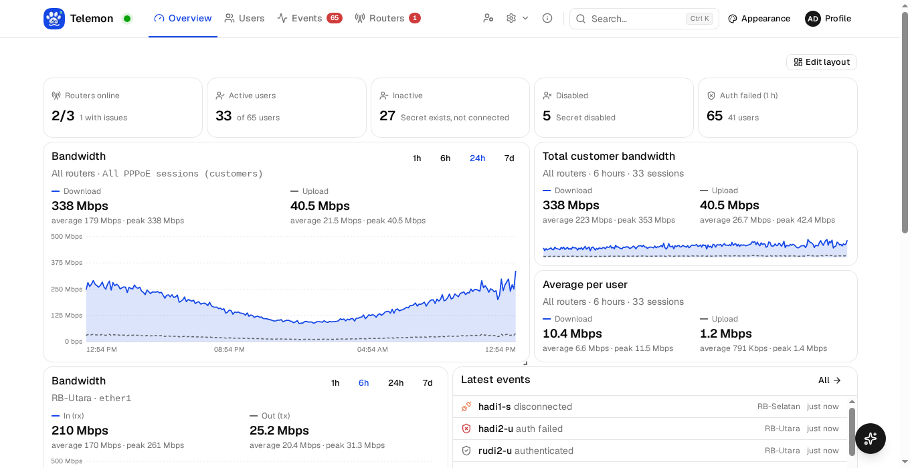

> Screenshots come from the bundled demo server with simulated routers and made-up users. No real data. The desktop-app image is the demo in desktop mode with simulated window buttons, not a capture of the packaged app.

> [!WARNING]
> **Pre-release (`v0.1.0-rc.x`).** The core, server and UI are tested against a *simulated* RouterOS. Telemon has <ins>not</ins> been run against a real MikroTik router yet (this includes the bandwidth charts, Router health and the SSH terminal). Treat it as a release candidate and **keep write access off until you have tried it on a lab router.** See the [full status](#status).

## Contents

- [What is Telemon?](#what-is-telemon)
- [Quick start](#quick-start)
- [Features](#features)
- [Screenshots](#screenshots)
- [Install](#install)
- [How it works](#how-it-works)
- [Documentation](#documentation)
- [Development](#development)
- [Status](#status)
- [Disclaimer](#disclaimer)
- [License](#license)

## What is Telemon?

Telemon reads each router over the **RouterOS API** and shows you, in one dashboard:

- **who is connected**, who is inactive and who is disabled;
- **what just happened**: auth failed, authenticated, connected, disconnected.

The MikroTik router stays the **source of truth**. Telemon imports from it and, when you allow it, writes PPP secrets and profiles back after a review step.

It runs as a **desktop app** with its own local database (nothing to deploy), and one switch turns it into a server so you can open the same dashboard from a laptop or a phone.

## Quick start

1. **[Install](#install)** Telemon and open it. The desktop app needs no login.
2. **Add a router.** Open *Routers* and add its host, port (8729 with TLS is recommended, 8728 without) and an API username and password. Use a **dedicated API account**: the built-in `read` group is enough for monitoring.
3. **Check the router certificate** if you use TLS: compare the fingerprint Telemon shows with the one on the router, then trust it.
4. **Wait for the first poll.** The router, its users and its events show up in *Overview*, *Users* and *Events*.
5. **Optional:** import users from the router, share the dashboard to a browser, or turn on the AI assistant.

The docs have a step-by-step guide: [Getting started](docs/wiki/Getting-Started.md).

## Features

### Monitoring

- **Multi-router monitoring.** Users with a status (active, inactive, disabled, auth failed), live events, per-router health, filters and search.
- **Overview as widgets.** A grid of widgets (counters, router cards, latest events, events per hour, users per profile and more). Accounts with the Overview *Edit* permission can drag, resize, add and remove widgets; the layout is shared by every account. Editing is on screens medium and wider; phones show one column.
- **Bandwidth charts.** Telemon reads each router's interface counters on an interval you set (default 60 s, kept 7 days). Three widgets use it: a chart per router and interface, the total across PPPoE sessions, and the average per active user.
- **Search everywhere.** Press <kbd>Ctrl</kbd>+<kbd>K</kbd> (<kbd>⌘</kbd>+<kbd>K</kbd> on a Mac) for a Spotlight-style palette. *Menu* is searched by default; *Routers*, *Users* and *Other* are switches under the palette or in Appearance.

### Changing things on the router

- **Write back, with review.** Add, edit and soft-delete PPP secrets and profiles after a review dialog, with a change history. Writing is **off per router by default**, and Telemon never deletes a secret or profile on the router: it disables or marks them.
- **Who may write.** The desktop app, and browser accounts whose role has the *Edit* permission (two-factor required). Writing over Public access is off unless the desktop owner turns it on.

### Sharing and access

- **Share to a browser.** One switch turns the desktop app into a LAN server for laptops and phones.
- **Public access.** An optional Cloudflare Quick Tunnel exposes the server to the internet. Telemon downloads a pinned, checksum-verified `cloudflared` for you. While it is on, two-factor authentication is **forced** and the tunnel turns off by itself after a timer.
- **Accounts and roles.** Browser access uses login with TOTP two-factor authentication and recovery codes, custom roles with per-menu permissions (no access, view, edit) and protection against privilege escalation. The desktop app itself needs no login.

### AI assistant (optional)

Off until you add a provider. Ask questions about your users and events in plain language. It supports OpenAI-compatible APIs (OpenAI, DeepSeek, Gemini, 9Router) and Anthropic, only reads data the asker's role may see, **masks IPs and MACs by default**, never sees passwords, and has a monthly budget with a usage dashboard.

<details>
<summary>What it can do</summary>

Besides lookups it can compute **event statistics** (per hour or day, most auth failures and disconnects), a **bandwidth summary** (now, average, peak, per user, change versus the previous period, per router) and **router health** (downtime and availability). It can also **propose Overview widget changes**: a proposal appears as a card and nothing changes until you press *Apply*, which uses your own permission.

</details>

> [!NOTE]
> Customer data is sent to the AI provider you choose.

### Extensions (official only for now)

Signed `.tmx` packages (Ed25519) add features to the app: Overview widgets, pages, router actions, bottom-panel tabs, scheduled workers, API routes and a sandboxed WASM backend, with their own database tables.

- **Install** from the built-in store (a signed catalogue), or from a file or link. Dependencies and Telemon version ranges are checked first.
- **Every permission has a toggle** that the core enforces. Each extension has its own *Access* page per role (none, view, edit plus declared actions). Changes are audited.
- **Each extension has its own license**, set by its publisher (free, open source, freemium, paid or other) and shown on its page. Telemon does not sell, verify or enforce it.
- The first extensions are **Router health** and **Router terminal (SSH)**. The terminal opens from a router's action menu in a bottom panel, pins the router's SSH host key and needs the Router *Edit* permission.
- On by default in the desktop app; off on a server until `TELEMON_EXTENSIONS=1`.

Extension packages live in [`telemon-extensions`](https://github.com/teliti-dev/telemon-extensions); this repository holds the host and the SDK contract (`src/lib/extensions/sdk.ts`).

### Look and feel

- **Compact header and menu.** The header holds the logo and Appearance (plus your account in a browser) with the compact menu underneath: Overview, Users, Events, Routers and one **Settings** dropdown (Settings, Manage, About). In the desktop app a green **Live** dot opens a status popup.
- **One title bar.** On Windows, Linux and macOS the header doubles as the title bar, the same compact look everywhere. The desktop window has a minimum and maximum size.
- **Bilingual** (English and Indonesian), light and dark themes, responsive down to phone width.

### Security and storage

- **Encrypted secrets.** Router credentials and PPPoE passwords are encrypted (ChaCha20-Poly1305). The database key lives in the OS keyring, with a `0600` file fallback when no keyring is available. TLS to the router supports certificate fingerprint pinning.
- **Signed in-app updates** with a stable and a test channel. The database is backed up before an update installs.

## Screenshots

| Users | User detail |
|---|---|
| 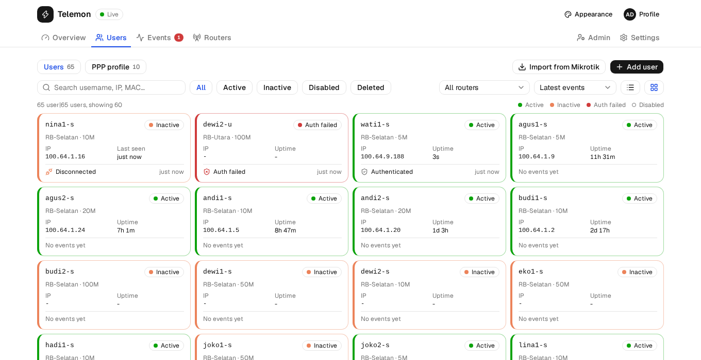 |  |

| Events | Settings |
|---|---|
| 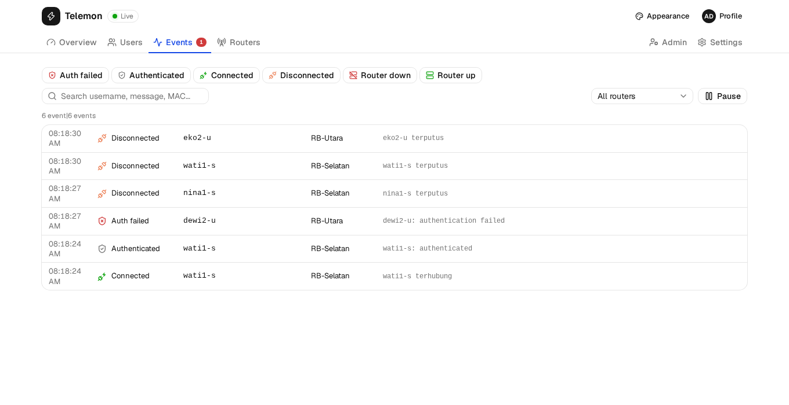 | 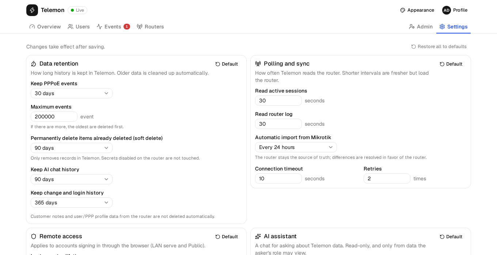 |

| Command palette (<kbd>Ctrl</kbd>+<kbd>K</kbd>) | Extensions |
|---|---|
| 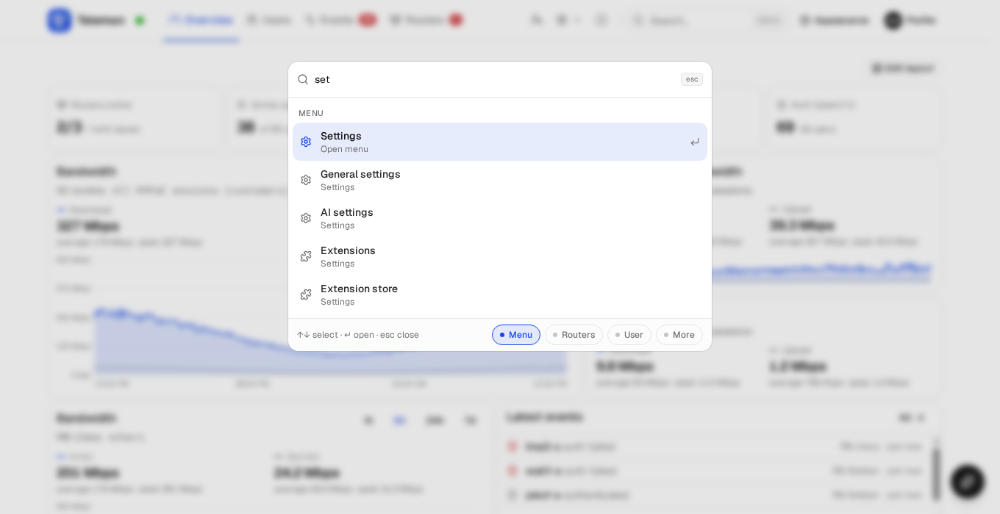 | 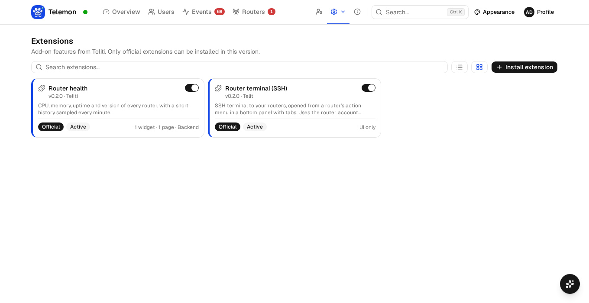 |

| Settings menu | Desktop app (compact title bar) |
|---|---|
| 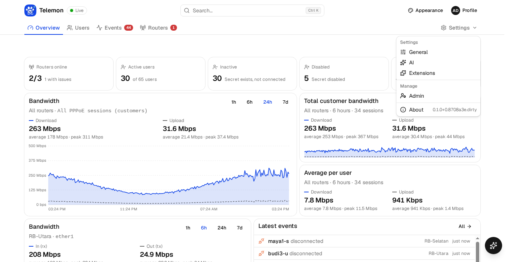 | 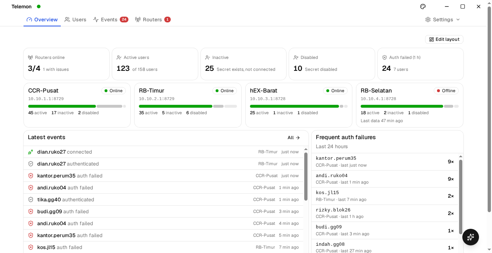 |

**AI dashboard** (Settings): providers, tokens per day, balance and monthly budget.

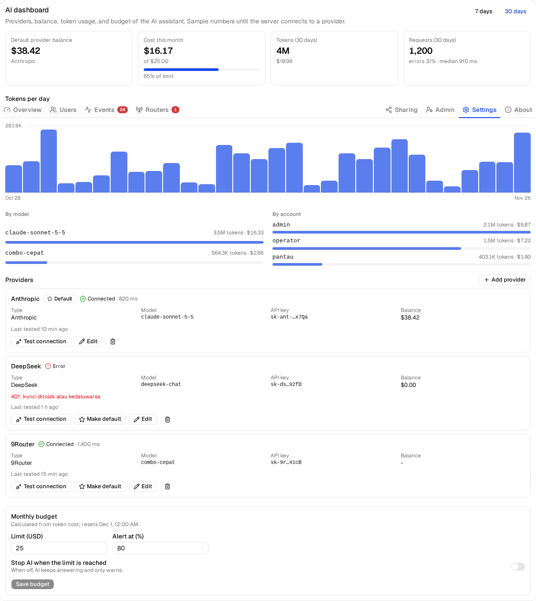

| Dark theme | Phone | Phone | Sign in |
|---|---|---|---|
|  |  | 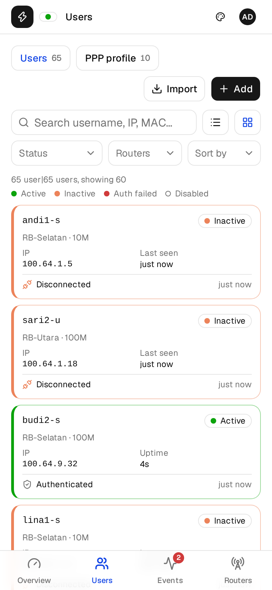 | 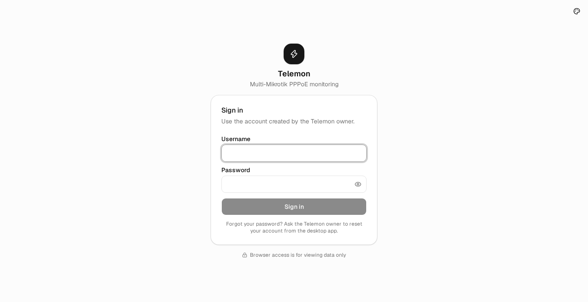 |

## Install

### Download

Get the file for your system from the [**Releases**](https://github.com/teliti-dev/telemon/releases) page and check it against `SHA256SUMS.txt`.

| System | File | Updates |
|---|---|---|
| **Windows** | `Telemon_<version>_x64-setup.exe` | In app |
| **Linux** | `Telemon_<version>_amd64.AppImage` | In app |
| **Debian, Ubuntu** | `Telemon_<version>_amd64.deb` | Notified only; install the new `.deb` yourself |

> [!NOTE]
> **macOS is not built or published** for now. The release workflow no longer produces a macOS app; the macOS-specific code stays in the repository.

### Good to know

- **Windows shows a SmartScreen warning.** The installer is not code-signed yet. Click **More info**, then **Run anyway**.
- **Updates are verified.** Release files carry a minisign signature (`.sig`) that the in-app updater checks. Pre-releases are on the **test channel**; stable releases will use the stable channel (there is none yet).
- **Your data stays.** Telemon keeps its database in your user data folder, separate from the program, so updating or reinstalling does not remove it. Back it up before you test a pre-release.

## How it works

```
 MikroTik routers ──RouterOS API──▶ telemon-core (poller, SQLite, accounts)
                                         │
                      loopback server (127.0.0.1, per-launch token)
                                         │
                          Desktop webview (no login)
                                         │
              optional: LAN server ──▶ browsers and phones (login + 2FA, per role)
                                         │
              optional: Cloudflare Quick Tunnel ──▶ public URL (2FA forced, auto-off)
```

The desktop window loads the same web UI over a loopback HTTP server that only answers requests carrying a token generated at launch. LAN and public access are separate listeners with account login.

## Documentation

| Where | What |
|---|---|
| **[User guide](docs/wiki/Home.md)** | User guide: getting started, routers, users and events, sharing, accounts, AI, extensions, updates, troubleshooting |
| [`DISCLAIMER.md`](DISCLAIMER.md) | Warranty, liability and the risks specific to Telemon |
| [`CLAUDE.md`](CLAUDE.md) and [`AGENTS.md`](AGENTS.md) | Conventions for people and tools working on the code |

Code comments refer to architecture decisions by number (for example "ADR 0021"). Those decision records are maintained separately by the maintainers and are not part of this repository.

## Development

**Requirements:** [bun](https://bun.sh), and a stable Rust toolchain for the crates.

```sh
bun install
bun run dev            # UI only, in the browser
bun run tauri dev      # full desktop app (needs the Tauri system dependencies)
```

<details>
<summary>Checks</summary>

```sh
bun run typecheck && bun run lint && bun run i18n:check
(cd crates/telemon-core    && cargo test)
(cd crates/telemon-http    && cargo test)
(cd crates/telemon-ai      && cargo test)
(cd crates/telemon-ext     && cargo test)
(cd crates/telemon-desktop && cargo test)
```

</details>

<details>
<summary>Try the UI without a router</summary>

The demo server uses simulated routers and a public demo password. It is **for trying the UI only**.

```sh
bun run build
cd crates/telemon-demo && cargo build --release
./target/release/telemon-demo --static ../../dist     # http://127.0.0.1:7878
```

</details>

### Project layout

| Path | What is in it |
|---|---|
| `src/` | React UI (Vite, TypeScript, shadcn/ui) |
| `crates/telemon-core` | RouterOS client, poller, storage and accounts |
| `crates/telemon-http` | Axum server |
| `crates/telemon-ai` | AI assistant (LLM clients, read-only tools) |
| `crates/telemon-ext` | Extension packages, manifests and the WASM runtime |
| `crates/telemon-ssh` | SSH terminal for extensions |
| `crates/telemon-desktop` | Desktop wiring and `cloudflared` management |
| `src-tauri` | The Tauri shell |

### Releasing

Create a GitHub Release with a tag `vX.Y.Z`. `.github/workflows/release.yml` builds Linux (`.deb`, `.AppImage`) and Windows (NSIS `.exe`, cross-compiled on Linux), signs the updater artifacts, and uploads them with `SHA256SUMS.txt` and `latest.json`. Prereleases are published to the `channel-rc` test channel.

## Status

Pre-release (`v0.1.0-rc.x`).

| Area | State |
|---|---|
| Core, server and UI | Tested against a **simulated** RouterOS |
| Real MikroTik routers | **Not tried yet** (including bandwidth charts, Router health and the SSH terminal) |
| Linux `.deb` | Smoke-tested in a clean Ubuntu 24.04 container (installs, starts, serves the UI in the real webview) |
| Windows | Tried on a real PC by the maintainer and works; installer not code-signed |
| Linux keyring | Real desktop keyring not tried |
| macOS | Not built for now (an earlier macOS build crashed at launch on at least one Apple Silicon Mac) |
| Linux custom title bar | Tried on one Cutefish VM only |

## Disclaimer

Telemon is provided **as is, without warranty**. To the extent the law allows, Teliti, the authors and the contributors are **not liable** for any damage from using it, such as lost, deleted or exposed data, a security breach, a router misconfiguration or downtime.

Telemon can change your routers, so **read the review dialog, keep your own backups and secure access.** Read the [full disclaimer](DISCLAIMER.md).

## License

**[AGPL-3.0](LICENSE).** Telemon uses the AGPL-licensed `mikrotik-rs` client.

Extensions are add-ons made by their publishers, and **each extension has its own license** (free, open source, freemium, paid or other) that its page shows; Telemon does not sell, verify or enforce it. The [Extension Exception](EXTENSION-EXCEPTION.md) (an additional permission under AGPL section 7) lets developers license their own extensions as they like, as long as the extension only uses the documented extension interface.

---

<p align="center">Copyright © 2026 <a href="https://teliti.net/">Teliti</a>. See <a href="NOTICE">NOTICE</a>.</p>
