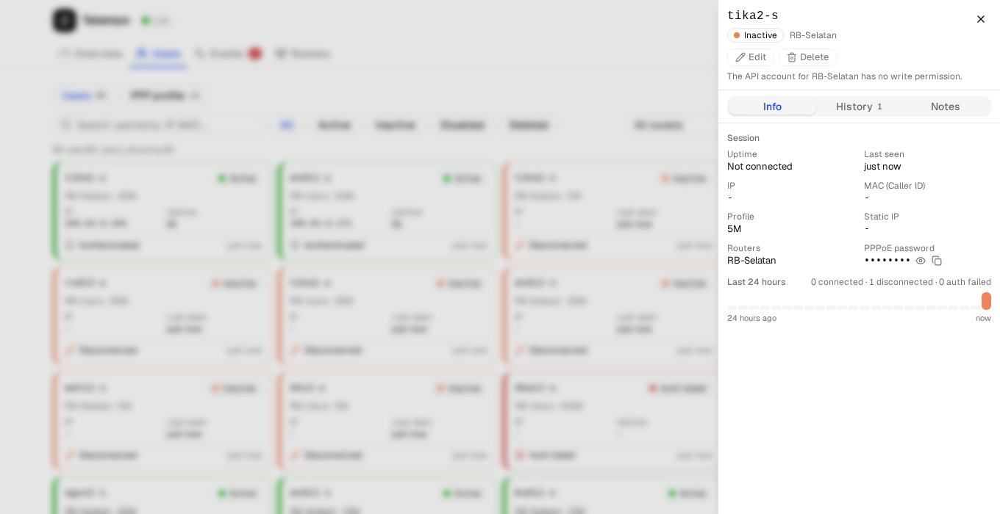
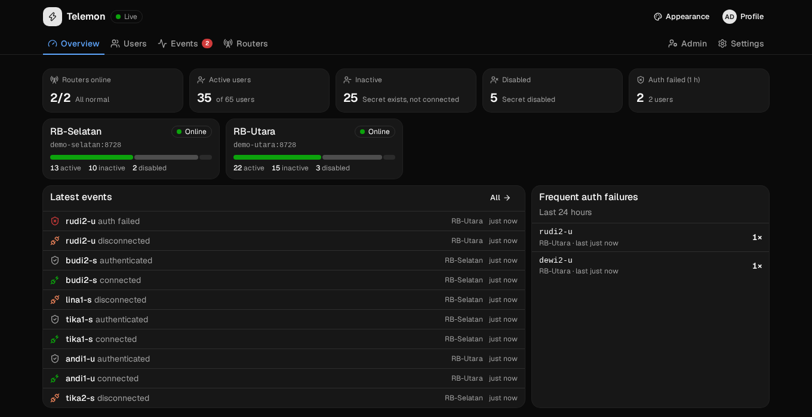
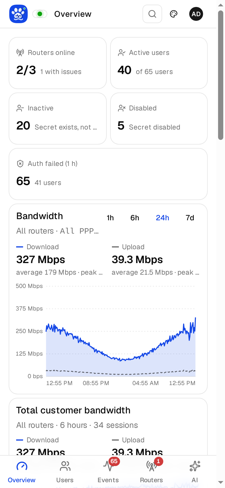

# Telemon

Monitor PPPoE users and events across many MikroTik routers, from a desktop app or any browser.

Telemon reads each router over the RouterOS API and shows who is connected, who is inactive or disabled, and what just happened (auth failed, authenticated, connected, disconnected). The MikroTik router stays the source of truth: Telemon imports from it, and when you allow it, writes PPP secrets and profiles back with a review step.


> Screenshots come from the bundled demo server with simulated routers and made-up users. No real data.

## Status

Pre-release (`v0.1.0-rc.x`). The core, server and UI are tested against a simulated RouterOS. **It has not been run against a real MikroTik router yet.** The Linux `.deb` has been smoke-tested in a clean Ubuntu 24.04 container (installs, starts, serves the UI in the real webview); Windows and a real desktop keyring have not been tried. Treat it as a release candidate and keep write access off until you have tried it on a lab router.

## Features

- **Multi-router monitoring.** Users with status (active, inactive, disabled, auth failed), live events, per-router health, filters and search.
- **Desktop app** (Windows and Linux, Tauri v2) with a local SQLite database. No server to deploy.
- **Share to a browser.** One switch turns the desktop app into a LAN server so you can open the same UI from a laptop or phone.
- **Public access.** An optional Cloudflare Quick Tunnel exposes the server to the internet. Telemon downloads a pinned, checksum-verified `cloudflared` for you. While public access is on, two-factor authentication is forced and the tunnel turns off by itself after a timer.
- **Accounts and roles** for browser access: login with TOTP two-factor authentication and recovery codes, custom roles with per-menu permissions (no access, view, edit), and protection against privilege escalation. The desktop app itself needs no login.
- **Write back to the router** (desktop only, per router, off by default): add, edit and soft-delete PPP secrets and profiles after a review dialog, with a change history. Telemon never deletes a secret or profile on the router; it disables or marks them.
- **Secure storage.** Router credentials and PPPoE passwords are encrypted (ChaCha20-Poly1305). The database key lives in the OS keyring, with a `0600` file fallback when no keyring is available. TLS to the router supports certificate fingerprint pinning.
- **Signed in-app updates** with a stable and a test channel. The database is backed up before an update installs.
- **Bilingual UI** (English and Indonesian), light and dark themes, responsive down to phone width.

| Users | User detail |
|---|---|
|  |  |

| Events | Settings |
|---|---|
|  |  |

| Dark theme | Phone | Phone | Sign in |
|---|---|---|---|
|  |  |  |  |

## Install

Download the file for your system from the [Releases](https://github.com/teliti-dev/telemon/releases) page and check it against `SHA256SUMS.txt`.

| System | File | Updates |
|---|---|---|
| Windows | `Telemon_<version>_x64-setup.exe` | In app |
| Linux | `Telemon_<version>_amd64.AppImage` | In app |
| Debian, Ubuntu | `Telemon_<version>_amd64.deb` | Notified only; install the new `.deb` yourself |
| macOS 11+ (Apple Silicon and Intel) | `Telemon_<version>_universal.dmg` | In app |

The Windows installer is not code-signed yet, so SmartScreen will warn on first run. The macOS app is signed ad-hoc but not notarized (no Apple Developer account yet): on first launch, right-click the app and choose **Open**, or run `xattr -cr /Applications/Telemon.app`. The macOS build has been compiled and packaged by CI but not yet run on a Mac. On macOS the automatic `cloudflared` download for public access is not available yet; LAN sharing works. Release files carry a minisign signature (`.sig`) that the in-app updater verifies.

Pre-releases are on the test channel. Stable releases will use the stable channel; there is none yet.

## How it works

```
 MikroTik routers ──RouterOS API──▶ telemon-core (poller, SQLite, accounts)
                                         │
                      loopback server (127.0.0.1, per-launch token)
                                         │
                          Desktop webview (no login)
                                         │
              optional: LAN server ──▶ browsers and phones (login + 2FA, per role)
                                         │
              optional: Cloudflare Quick Tunnel ──▶ public URL (2FA forced, auto-off)
```

The desktop window loads the same web UI over a loopback HTTP server that only answers requests carrying a token generated at launch. LAN and public access are separate listeners with account login.

## Development

Requirements: [bun](https://bun.sh), and a stable Rust toolchain for the crates.

```sh
bun install
bun run dev            # UI only, in the browser
bun run tauri dev      # full desktop app (needs the Tauri system dependencies)
```

Checks:

```sh
bun run typecheck && bun run lint && bun run i18n:check
(cd crates/telemon-core    && cargo test)   # 96 tests
(cd crates/telemon-http    && cargo test)   # 36 tests
(cd crates/telemon-desktop && cargo test)   # 14 tests
```

Try the UI without a router, using the demo server (simulated routers, public demo password, **for trying the UI only**):

```sh
bun run build
cd crates/telemon-demo && cargo build --release
./target/release/telemon-demo --static ../../dist     # http://127.0.0.1:7878
```

Layout: `src/` React UI (Vite, TypeScript, shadcn/ui), `crates/telemon-core` RouterOS client, poller, storage and accounts, `crates/telemon-http` Axum server, `crates/telemon-desktop` desktop wiring and `cloudflared` management, `src-tauri` the Tauri shell.

## Releasing

Create a GitHub Release with a tag `vX.Y.Z`. `.github/workflows/release.yml` builds Linux (`.deb`, `.AppImage`), Windows (NSIS `.exe`, cross-compiled on Linux) and macOS (universal `.dmg`, on a macOS runner), signs the updater artifacts, and uploads them with `SHA256SUMS.txt` and `latest.json`. Prereleases are published to the `channel-rc` test channel.

## Design notes

Code comments refer to architecture decisions by number (for example "ADR 0021"). Those decision records are maintained separately by the maintainers and are not part of this repository.

## License

[AGPL-3.0](LICENSE). Telemon uses the AGPL-licensed `mikrotik-rs` client.
